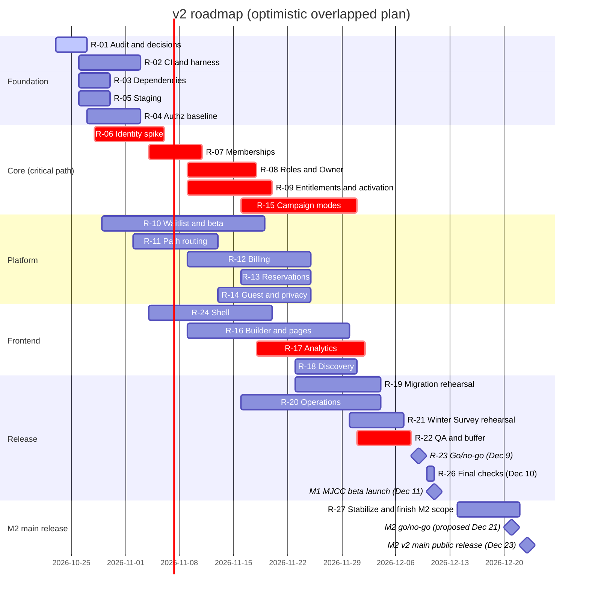

# LunchVoice v2 execution roadmap

Planning deliverable, created **2026-10-23 (Friday), America/New_York**.
Status: **proposal for founder review**. Nothing here is implemented, approved,
provisioned, deployed or migrated. Companion plans:
[data and migration](DATA_AND_MIGRATION_PLAN.md),
[API and authorization contracts](API_AND_AUTHORIZATION_CONTRACTS.md),
[Campaign and entitlement](CAMPAIGN_AND_ENTITLEMENT_PLAN.md),
[privacy and operations](PRIVACY_AND_OPERATIONS_PLAN.md) and the
[frontend experience plan](../frontend/EXPERIENCE_PLAN.md).

Confirmed requirements (V2-xx) come only from
[PRODUCT_SPEC.md](../v2/PRODUCT_SPEC.md). Everything labelled **Recommendation**,
**Estimate** or **Assumption** below is engineering judgment, not a founder decision.

**Scope statement.** The full confirmed v2 scope (identity, multi-Hub membership,
roles, entitlements, Campaign modes, billing, name reservations, guests/anonymity,
Builder, analytics with exports and embeds, discovery, beta) remains the target. The
three options in [section 8](#8-capacity-versus-scope-and-options) are all kept
visible. **Option B is my recommendation only; it is not an approved scope
reduction**, and billing, reservations, elections and embeds are **not** approved
deferrals. Section 8.1 gives the latest decision date and consequence for each.

## 0. Schedule update (founder message, relayed 2026-10-23)

Per the founder's message relayed on 2026-10-23 (no primary document was provided; recorded
as supplied):

| Date (2026, America/New_York) | Milestone | Status |
| --- | --- | --- |
| Nov 12 (Thu) | Waitlist / internal prototype | Still **proposed** |
| **Dec 9 (Wed)** | **Launch-readiness go/no-go review** | Recommended in the same message (adopted in this plan; awaiting explicit founder confirmation) |
| Dec 10 (Thu) | Final checks and necessary fixes only (change freeze for new features) | Recommended |
| **Dec 11 (Fri)** | **MJCC Hub and Winter Survey launch: first operational v2 beta** | Founder-supplied; needs separate production authority |
| Dec 14-22 | Stabilization, beta support and completion of remaining scope | Proposed |
| **Dec 23 (Wed)** | **LunchVoice v2 main public release** | Founder-supplied; needs its own go/no-go (proposed Dec 21) and separate production authority |

**Founder approvals recorded (message of 2026-10-23 ending "I approve", after a list of recommendations).**
The message does not say which items "I approve" covers, so this plan reads it as covering all of the listed
recommendations; **the founder should confirm that reading, especially for items 1 and 2.** Approved: (1) **Dec 9 as the go/no-go review with Dec 10 for final checks**; (2) the **M1/M2 split** below as the
agreed delivery plan, with Options A and C retained as contingency; (3) preparing the **CI/checks PR, the
dependency-fix PR and the staging manifest** within non-production scope; (4) **isolated verification** of the
unverified authorization-baseline question before identity and membership work depends on it. **Not yet
supplied:** the survey operator and launch-support owner; the survey's opening time, timezone, closing date,
questionnaire, audience and anonymity requirement; the staging budget and resource owner. Production deployment,
migrations and paid-resource creation remain unapproved.

**M1 / M2 split** (recorded as approved on 2026-10-23 under the reading above; it replaces the three
alternative plans as the delivery plan, which stay as contingency):

| M1: Dec 11 MJCC beta | M2: Dec 23 public release |
| --- | --- |
| Central login and safe existing-account mapping | Public creator onboarding and billing |
| MJCC Hub, membership, roles and Owner controls | Seasonal purchases and paid slug reservations |
| Winter Survey creation, scheduling, QR/join links, responses, completion | Additional Campaign modes, including elections once their rules are approved |
| Required guest/anonymity controls and privacy-safe results | Analytics embeds and discovery |
| Branding, navigation and the pages MJCC actually needs | Expanded Builder features and remaining community pages |
| Tested migration, recovery and operator procedures | Public-release hardening and support readiness |

Shared foundations for M2 items are built **before** the beta; M2 items are released later, not started after
Dec 12. MJCC recommendation (not yet approved): evolve the existing LionCafe organization into the MJCC Hub,
preserving its users, history, points and links; create a separate Hub only for deliberate separation. This
choice must be confirmed before migration work (D-12).

Consequences: Dec 11 can no longer also be the first readiness review (the earlier plan
used Dec 11 as the review date); the review moves to **Dec 9**. The roadmap window,
originally requested as Oct 23-Dec 11, now covers **Oct 23-Dec 23** in two milestones:
**M1 = MJCC beta (Dec 11)** and **M2 = main public release (Dec 23)**. Which confirmed
capabilities belong to M1 versus M2 is a **founder decision** (section 8); nothing is
removed from v2. Dec 23 falls the week before Christmas and Dec 11 is a Friday, so
support coverage after each launch is a stated risk (section 12).

## 1. Elapsed-time honesty

- The window is **Oct 23 - Dec 23, 2026 inclusive** (62 calendar days). Today is day 1.
  No implementation has started; only audit and planning exist. Progress is never
  backdated. If implementation starts later than **Mon Oct 26**, re-run section 8
  (capacity) with the real start and shift every date by the slip; items on the
  critical path (section 7) cannot absorb slip without losing buffer.
- Working days from Oct 26 (Thanksgiving, Nov 26-27, treated as non-working; Nov 11
  working): **31 through the Dec 9 review**, **33 through Dec 11**, **41 through Dec 23**.
  Oct 23 is used for planning only. Dec 24-25 are not counted.
- Calendar facts: Nov 12 is a Thursday; **Dec 9 is a Wednesday, Dec 11 a Friday, Dec 13
  (the earlier provisional target) a Sunday, Dec 23 a Wednesday**; US daylight saving
  time ends Sunday Nov 1, so Nov 1 has 25 hours in America/New_York (relevant to scheduled
  windows, see [Campaign plan](CAMPAIGN_AND_ENTITLEMENT_PLAN.md)).

## 2. Winter Survey: what is confirmed and what is not

**MJCC Hub Winter Survey 2026** is the M1 launch event. Repository search (source, SQL,
changelog, docs) found **no** survey details. The founder's relayed message (section 0)
states the **opening date is confirmed: Friday, December 11, 2026**, the day MJCC launches
its Hub and the Winter Survey. Everything else is still open under decision **D-12**.

| Item to confirm | Current evidence | Who confirms | Needed by |
| --- | --- | --- | --- |
| Opening **date** | **Dec 11, 2026**, founder-supplied (relayed message; no primary document) | Founder | Confirmed |
| Opening **time and timezone** | None | Founder / MJCC operator | Oct 30 |
| Closing date/time | None | Founder / MJCC operator | Oct 30 |
| Named operator (who runs it, who accepts rehearsal) | Unassigned | Founder | Oct 30 |
| Questionnaire (question types, count, languages) | None; existing templates support rating, slider, yes/no, single/multi choice, text, NPS-like and flame/slider types | MJCC operator | Nov 6 |
| Audience (existing LionCafe students only? staff? new accounts?) | None; drives guest/identity/anonymity design | Founder | Oct 30 |
| Anonymity requirement for this survey | v1 stores student ID on responses (not anonymous to admins) | Founder | Nov 6 |
| Hub name/slug and its relationship to the existing LionCafe org (same Hub, or new MJCC Hub containing LionCafe dining features) | Spec says dining features remain LionCafe tenant features; MJCC Hub identity not specified | Founder | Oct 30 |
| Fallback plan | **Proposed below** | Founder | Oct 30 |

**D-12 stays open** (partially resolved: date only). The opening time is not inferred;
the closing date is not inferred; and neither is derived from the earlier Dec 13 target.

**Proposed fallback (Recommendation):** the existing LionCafe survey flow (templates,
sessions, join code/QR, results, points) is present in source and keeps working
through the transition. If v2 is not ready at go/no-go, run the Winter Survey on
the legacy flow under the unchanged LionCafe URLs and cut over afterwards. This
requires that no v2 migration step breaks the legacy session/response path before
the survey closes (see data plan, "freeze window").

With the opening on Dec 11 and the go/no-go on **Dec 9**, a no-go leaves **two days**
to switch to the legacy fallback. The fallback path therefore must be rehearsed and
kept intact from the start (R-21) rather than assembled after a no-go. If the opening
time turns out to be early on Dec 11, Dec 10 final checks must finish the day before.

## 3. Capacity and ownership assumptions

All of these are **assumptions** to be confirmed or corrected:

- **A1.** Claude is the governing implementation agent (per `AGENTS.md`); up to
  three or four concurrent lanes are possible only when file scopes do not overlap.
  No evidence yet establishes real agent throughput; effort below is in
  *agent-days of focused work plus review*, not calendar proof.
- **A2.** Founder review turnaround is one business day for PRs and decisions.
- **A3.** 75% productive utilisation (blocked waits, review, environment fixes).
- **A4.** No human engineer is assigned. All "Owner" cells say **Claude** (build),
  **Founder** (decide/accept) or **Unassigned: <role>** (a named human or vendor is
  required and does not yet exist in any document).
- **A5.** Staging resources (isolated database/auth/hosting) do not exist today and
  must be approved and provisioned by someone with authority. Planning does not
  provision them.
- **A6.** Local environment (this WSL checkout): Node 22.22.1, npm 9.2.0, Docker 29.1.3
  present; Supabase CLI and Deno **missing**; `core.hooksPath` unset. CI pins Node 22.12.0.

## 4. Audit refresh (what changed since the 2026-10-23 audit)

Verified on 2026-10-23 against `main` = `0dbc343227bdb8f3cd5745f59c0247ae84841aec`
(unchanged from the audit baseline; no drift in `main`).

| Check | Result |
| --- | --- |
| `npm audit` (registry advisories) | 5 entries: **3 high** (`nanoid`, `source-map-js`, `vite`), **2 moderate** (`react-router`, `react-router-dom`); same as the audit; fixes are reported available, some may be major-version |
| PR checks on PR #2 | **None** (`statusCheckRollup` empty): the only workflow runs on push to `main` |
| Branch protection on `main` | **Not protected** (GitHub API 404); you have admin permission |
| Pre-push hook | Deploys edge functions when the diff touches `supabase/functions/`; **inactive in this clone** (`core.hooksPath` unset) and this branch touches none; still a hazard for implementation branches |
| Release policy heavy-test regex | Matches `src/contexts/Auth`, but the provider is `src/auth/AuthProvider.tsx`: auth edits can skip the heavy gate |
| Test coverage | One test file (`kpnsoluteWebhooks.test.ts`); no behavioural runner script |
| Routing | `/:orgSlug/*` catch-all in `src/main.tsx` treats any first path segment as a Hub slug: **platform routes such as `/pricing`, `/discover`, `/me` would be captured** unless reserved names are enforced |
| Signup trigger | `handle_new_user` still defaults to LionCafe when `org_id` metadata is absent |
| Staff provisioning | `provisionLunchvoiceStaff` links an existing auth user **by email** when no profile matches the MJCC username and scans up to 2,000 users per lookup; both are identity-linking and scale concerns for D-01 |
| Authorization baseline | **Unverified.** Effective grants and field-level write authority on identity-bearing tables have not been checked in any environment. No exposure in production is claimed. A verification proposal for an isolated environment is held privately by the founder (not in this repository) and tracked as R-04 |
| Live state | MJCCv2 grants, deployed migrations, functions, DNS, Render settings **not inspected** (no authority). Everything about production is **unverified** |

### 4.1 Launch-readiness impact of the audit findings

Evidence is from `main` at `0dbc343` and read-only checks on 2026-10-23. None of these was changed by this planning work.

| Finding | Source evidence | Impact on launch readiness | Roadmap item |
| --- | --- | --- | --- |
| Dependency advisories: 3 high (`nanoid`, `source-map-js`, `vite`), 2 moderate (`react-router`, `react-router-dom`) | `npm audit --json` run 2026-10-23 in WSL (Node 22.22.1); `package.json:15` defines `test:heavy` as `npm audit --audit-level=high` | The existing heavy release gate would **fail** today; DoD OPS-1 cannot be met until remediated. Advisory text is registry evidence, not proof of exploitability here | R-03 |
| No PR checks | `.github/workflows/version-release.yml:3-5` triggers only on `push` to `main`; `gh pr view 2` returns an empty `statusCheckRollup`; `.github/` contains only `workflows/` | A PR can merge with **no** automated validation; behaviour changes would reach `main` (and its tag/deploy pipeline) unchecked. DoD OPS-2 unmet | R-02 |
| `main` unprotected | GitHub API: `branches/main` `protected: false`; protection endpoint returns 404 | Nothing enforces review or checks before `main`, which triggers versioning and the Render pipeline; any later PR checks are advisory until protection is enabled (founder decision) | R-02 |
| Stale auth path in heavy-test selector | `scripts/release-policy.mjs:37` matches `src/(contexts/Auth\|lib/supabase)`; the provider is `src/auth/AuthProvider.tsx` | A commit touching only `AuthProvider.tsx` can skip the heavy gate that exists for auth/RLS changes; v2 identity work is auth-heavy, so this must be fixed **before** R-06/R-07 merge | R-02 |
| Platform-route collision | `src/main.tsx:99-109`: `/:orgSlug/*` is a catch-all; `/join` (line 106) and `/admin/*` (108) already redirect to LionCafe | v2 platform routes (`/pricing`, `/me`, `/signin`, `/join`, `/waitlist`) would be treated as Hub slugs or LionCafe redirects. Needs reserved names + route ordering + a redirect compatibility test, or the public pricing/waitlist/join pages break and a Hub could claim a platform name | R-11 |
| Pre-push hook deploys functions | `.githooks/pre-push`; `package.json:17` `postinstall` sets `core.hooksPath` | An implementation branch touching `supabase/functions/` would deploy to the linked project on push. Inactive in this clone (`core.hooksPath` unset) and not triggered by this docs-only branch; must be neutralized or gated before R-06 | R-02 |
| Legacy provisioning concerns | `supabase/functions/_shared/staffAccess.ts:31-32` pages `listUsers` up to 20x100; `:54` matches by `mjcc_username`, falls back to email | Identity-linking behaviour and a 2,000-user scan ceiling are inputs to the D-01 spike, not release blockers by themselves | R-06 |
| Signup default tenant | `0008_handle_new_user_org.sql:18` falls back to LionCafe | Must be replaced by verified membership provisioning before any second Hub accepts signups | R-07 |

Classification of capabilities (implemented / partial / missing / external / unverified)
is in the [data plan](DATA_AND_MIGRATION_PLAN.md#1-current-capability-classification).

## 5. Roadmap items

Fields per item: **Req** requirement / system / **Reuse** / **Deliver** deliverable +
PR scope / **Owner** / **Needs** dependencies and resources / **Dates** (2026), effort
(agent-days low-high), confidence / **Decide** decision deadline and blockers /
**Accept** acceptance tests and evidence / **Fallback**. Status key: *planned*,
*in progress*, *blocked*, *complete*. Dates are the **optimistic overlapped plan**;
section 8 explains why that is not a safe plan of record.

### Lane A: Foundation and core (critical path)

**R-01 Audit refresh, decision packet, Winter Survey confirmation request**
- Req: planning prerequisite for every item. Reuse: existing docs. Deliver: this PR.
- Owner: Claude (planning), Founder (answers). Needs: founder replies to D-12 questions.
- Dates: Oct 23-27; 1-2 d; confidence high. Status: **in progress**.
- Decide: D-12 by Oct 30. Accept: PR reviewed; each D-xx has owner and date.
- Fallback: proceed on independent items (R-02, R-03) while waiting.

**R-02 Verification infrastructure (Core-0a)**
- Req: DoD OPS-2, OPS-3; system: CI, tests. Reuse: `check:brain`, `check:release`, Node 22.12.0 pin.
- Deliver (PR `ci/pr-checks`): PR workflow that runs brain, release-policy, build, tests
  and **never tags or deploys**; fix heavy-test regex to `src/auth/`; install
  Supabase CLI and Deno in CI; local Postgres replay of all migrations; test harness
  with two-Hub synthetic fixtures; behavioural runner script.
- Owner: Claude. Needs: Docker (present), Supabase CLI, Deno, GitHub Actions minutes.
- Dates: Oct 26-Nov 3; 3-5 d; confidence medium.
- **Status (2026-10-23): first slice in progress.** PR [#5](https://github.com/KpnSolute/Lunchvoice/pull/5) (stacked on #4) adds
  the `pull_request` workflow, the `pr` policy mode, the corrected heavy-test selector, a bundle smoke check and
  7 script tests; its first real GitHub run passed (2 checks). **Remaining (R-02b):** local Postgres replay and two-Hub
  allow/deny/concurrency tests. Finding from local replay: `0001_baseline.sql` does **not** replay cleanly on an empty
  database (25 errors; policies reference `is_admin()` before it is defined), so the harness must either tolerate the
  baseline's known errors, as a live database effectively did, or use a captured schema dump; the 15 later migrations replay
  cleanly on stubbed platform roles/`auth`. Also found: builds without `VITE_SUPABASE_*` are vacuous (see R-03/#4).
- Decide: whether to enable branch protection requiring the new checks (Founder, Oct 30).
- Accept: PR shows green run; a deliberately broken migration/policy fails; no workflow
  can push a tag from a non-`main` ref. Fallback: run the suite locally and attach logs
  until CI exists (labelled as local evidence, not CI).

**R-03 Dependency advisory remediation (Core-0b)**
- Req: DoD OPS-1. Reuse: lockfile. Deliver (own PR): update `vite`, `nanoid`/`source-map-js`
  (transitive) and assess `react-router` 6.x advisories (fix may require the v7 migration).
- Owner: Claude. Dates: Oct 26-30 (to Nov 4 if router major migration is needed); 1-3 d; confidence medium.
- **Status (2026-10-23): PR [#4](https://github.com/KpnSolute/Lunchvoice/pull/4) open (lockfile only).** The three high advisories
  are remediated (`npm audit --audit-level=high` exits 0 locally). Two moderate `react-router` advisories remain; their fix needs
  React Router 7 (major), documented as residual risk with a call-site assessment. `test:heavy` was run locally on Node 22.22.1,
  not yet on the CI-pinned 22.12.0. A preview smoke test is advisable before merging to `main`.
- Decide: accept router v7 migration scope or document residual moderate risk (Founder, Oct 30).
- Accept: `npm run test:heavy` passes in Node 22.12.0 CI; build and smoke routes unchanged.
- Fallback: ship high fixes alone; list moderate advisories as residual with assessment.

**R-04 Authorization baseline review and hardening**
- Req: V2-18, DoD IDM-9; system: Supabase policies/grants. Reuse: existing policies as the test baseline.
- Deliver (PR `security/authz-baseline`): in an **isolated local or staging database**, verify
  effective grants and field-level write authority on identity-bearing tables; if a gap is
  confirmed, add additive migrations that tighten it plus deny/allow tests. Nothing is applied
  to production; no production probes are run.
- Owner: Claude. Needs: local Supabase CLI + Docker (R-02) or R-05 staging. Production inspection
  needs separate explicit authority and is the founder/operator's decision.
- Dates: Oct 27-Nov 3; 2-3 d; confidence medium. Status: **planned**. Verification status: **unverified**.
  The verification proposal is held privately (outside this repository); this public plan records neither
  specifics nor any claim of production exposure. **Update (2026-10-23):** an isolated local verification was performed on a
  throwaway database built from the repository's migrations; its results and any candidate fix are held privately by the
  founder. **Production status remains unverified**; no production probe was run. A broader review of write policies on other
  tables (insert/update checks that bind only to the organization) is part of this item; details are kept out of this public repository.
- Accept: direct PostgREST/RPC test suite shows denies in the isolated database; migrations replay cleanly.
- Fallback: if no isolated database is available, deliver the test suite and a migration marked
  "unverified", and leave any read-only production inspection to the founder/operator.

**R-05 Staging environment and resource ownership**
- Req: DoD OPS-3; resource map. Deliver: environment manifest (names, purpose, owner,
  secret-manager reference only), non-production Supabase project or branch, Render preview,
  Google OAuth test client, test accounts, sandbox billing account.
- Owner: **Unassigned: database/hosting operator**; Claude drafts the manifest.
- Needs: **paid-resource and credential authority from the founder** (not granted by this plan).
- Dates: Oct 26-30; 1-2 d plus waiting; confidence **low** (external).
- **Status (2026-10-23): manifest and cost estimate drafted** in [STAGING_MANIFEST.md](../archeture/STAGING_MANIFEST.md)
  (14 resources, rough envelope about $10-$50 per month, proposed cap $50 per month for 3 months, all unpurchased and to be
  re-verified), plus the [D-01 decision packet](D01_IDENTITY_DECISION_PACKET.md). **Awaiting founder:** budget cap, resource owners, Supabase
  organization, domain/DNS owner, and written permission to create resources.
- Decide: founder approval to provision by Oct 28. Blocks R-04, R-06, R-12, R-19.
- Accept: manifest reviewed; staging reachable; no production credentials used.
- Fallback: local Supabase CLI + Docker for all database work; identity and billing
  proofs then wait for staging, and the Nov 12 prototype is a labelled fixture prototype.

**R-06 Central identity contract and OIDC spike (Core-1)**
- Req: V2-03, DoD IDM-1/2; system: KpnSolute Identity, Supabase Auth, Google OIDC.
  Reuse: existing `auth.users` UUIDs, email-OTP and staff bridge as legacy paths.
- Deliver (spike branch, then PR): contract packet (issuer, JWKS, callbacks,
  claims, lifetimes, logout, linking), working option A in staging, scenario matrix
  (new Google user, existing OTP user, existing MJCC staff user, changed email same
  subject, conflicting account, revoked access, expired token, second-Hub access,
  provider outage).
- Owner: Claude (LunchVoice side); **Unassigned: Identity service owner** for
  `auth.kpnsolute.com`. Other repositories are not modified without separate scope.
- Needs: R-05, D-01, a Google OAuth client, Supabase plan that supports custom OIDC (**unverified** for this project).
- Dates: Oct 28-Nov 6; 5-8 d; confidence **low-medium**. Critical path.
- Decide: D-01 by Oct 30. Accept: scenario matrix passes in staging; UUID/response/points continuity shown.
- Fallback (needs founder approval, deviates from V2-03 wording): launch on
  Supabase's built-in Google provider for MJCCv2 with a documented migration to the central
  issuer later; Apple stays later in both cases.

**R-07 Memberships and compatibility mapping (Core-2)**
- Req: V2-02/04, DoD IDM-2/4/5. Reuse: `orgs`, `profiles.org_id`, `caller_org_id()`.
- Deliver (PR): additive `hub_memberships`, compatibility mapping, `caller_hub_ids()`,
  membership-based Hub switching; legacy `profiles.org_id` kept read-compatible.
- Owner: Claude. Needs: R-02, R-06 contract (can start on schema before spike completes). D-05 (valid member).
- Dates: Nov 4-11; 4-6 d; confidence medium.
- Accept: same account accepted in two Hubs; pending denied; cross-Hub reads denied; LionCafe IDs reconcile.
- Fallback: ship single-membership compat mode behind a flag and demonstrate two Hubs with fixtures.

**R-08 Roles, protected Owner, permission evaluation (Core-3)**
- Req: V2-07/18, DoD IDM-6..9. Deliver (PR): role/permission/assignment schema,
  capability evaluator, quota enforcement (3/6 slots), Owner transfer RPC, audit.
- Owner: Claude. Needs: R-07, D-02 by Nov 6. Dates: Nov 9-18; 5-8 d; confidence medium.
- Accept: concurrent fourth/seventh role denied; Owner uses no slot; escalation and cross-Hub grants denied; transfer atomic (never zero/two owners).
- Fallback: ship fixed role templates first; custom names/icons second.

**R-09 Entitlement engine, Campaign envelope, atomic activation (Core-4)**
- Req: V2-05/06/08/09/12, DoD CMP-1..6. Deliver (PR): `hub_entitlements`, Campaign
  envelope over existing sessions, activation RPC with row-lock serialization,
  versioned gate policy interface, synthetic fixtures, the Campaign fixtures table.
- Owner: Claude. Needs: R-07, R-08, **D-04 approved by Nov 6**; D-06/D-08 only for unknown caps (never assume unlimited).
- Dates: Nov 9-20; 6-9 d; confidence medium. Critical path.
- Accept: Starter 15/2, Team 5; final-slot race; gate boundary cases; retry never restarts a clock.
- Fallback: enforce known numeric caps only; hold additional-survey gate behind a disabled flag until D-04 is approved.

### Lane B: Platform, commerce, privacy

**R-10 Public waitlist and beta admission**
- Req: V2-16, DoD BLD-7. Reuse: marketing contact form (lead capture only).
- Deliver: waitlist table + public page (PR 1, Oct 29-Nov 10, 2-3 d); atomic 50-owner admission (PR 2, Nov 16-19, 2-3 d).
- Owner: Claude. Needs: D-07 by Nov 6 (unique-owner counting, transfers, re-entry, pricing). Confidence medium.
- Accept: simultaneous 50th/51st admission yields one winner; no invented exemptions.
- Fallback: waitlist-only until admission rules are approved.

**R-11 Canonical Hub path routing and reserved namespace**
- Req: V2-04, DoD IDM-3. Reuse: `OrgProvider`, `tenantSlugFromHostname`, `LionCafeRedirect`.
- Deliver (PR): reserved-name list and slug validation, platform routes registered before `/:orgSlug/*`, legacy subdomain/LionCafe redirect tests, deep-link preservation.
- Owner: Claude. Needs: D-09 (namespace, redirects) by Nov 4. Dates: Nov 2-13; 3-5 d; confidence medium.
- Accept: `/pricing`, `/discover`, `/me` never resolve as Hubs; existing LionCafe deep links resolve.
- Fallback: keep subdomain compatibility indefinitely.

**R-12 Billing adapter, subscriptions, seasonal windows (sandbox only)**
- Req: V2-05/06/10/11/12, DoD COM-1..4. Deliver (PRs): provider-agnostic adapter,
  verified idempotent event handler, subscription and seasonal-grant state, `19 + 13*extra_weeks` calculator, activation-clock persistence.
- Owner: Claude; **Unassigned: billing operator**. Needs: **D-06 provider by Nov 6**, D-08 by Nov 9, sandbox account.
- Dates: Nov 9-25; 6-10 d; confidence low (external provider).
- Accept: forged success URL, duplicate and out-of-order events, retries never double-grant. **Campaign Plus remains unsellable** until both prices are approved.
- Fallback: founder-issued manual entitlements recorded in the same grants table (no invented beta pricing).

**R-13 Name reservation and slug lifecycle**
- Req: V2-13/14, DoD COM-5..8. Deliver (PR): reservation state machine, 25-calendar-day grace,
  release worker, generation-bound claims. Owner: Claude. Needs: D-09 calendar by Nov 9, R-12, scheduler (R-20).
- Dates: Nov 16-25; 4-7 d; confidence medium.
- Accept: boundary tests at expiry/grace, leap-year anniversary, DST, delayed/retried jobs, renewal-vs-release race; reclaim exposes no prior data.
- Fallback: reservations offered manually; automated release deferred (founder approval needed).

**R-14 Guest access, anonymity, privacy boundary**
- Req: V2-19/21, DoD GST-1..4. Deliver (PRs): guest proof and scoped share tokens, anonymous response separation, suppression views.
- Owner: Claude. Needs: D-03, D-10 by Nov 9. Dates: Nov 13-25; 6-9 d; confidence medium. Detailed in the [privacy plan](PRIVACY_AND_OPERATIONS_PLAN.md).
- Accept: no raw/join/export/timestamp/small-cohort path identifies an anonymous respondent; guests never raise member counts.
- Fallback: authenticated anonymous campaigns only; guests deferred (founder approval).

**R-15 Campaign modes, targeting, scheduling, QR/join codes**
- Req: V2-19, DoD CMP-1. Reuse: Content Central, Survey, Surveys, join codes. Deliver (one PR per mode): poll, rating, feedback, election, seasonal; role/member targeting; scheduled activation via the same server gate.
- Owner: Claude. Needs: R-09, D-08 (mode/tier mapping). Dates: Nov 16-Dec 1; 8-14 d; confidence low-medium.
- Accept: each mode has its own contract tests; election procedures follow an approved contract.
- Fallback: ship Survey/poll/rating/feedback first; elections only with an approved contract (founder decision to defer).

### Lane C: Frontend (against reviewed contracts; mocks are labelled)

**R-24 Frontend shell: login, account/Hub switcher, participation receipt, creator workspace**
- Reuse: `Layout`, `Login`, `Gate`, `ContentCentral`. Deliver: see [experience plan](../frontend/EXPERIENCE_PLAN.md).
- Owner: Claude. Dates: Nov 4-20; 6-9 d; confidence medium. Needs: R-06/R-07 contracts. Fallback: mocks with explicit "preview" label.

**R-25 Design-manager handoff intake and verification**
- Req: frontend plan; system: Claude Design project (design manager), Codex as liaison.
  Status: **design work underway, not delivered**. Codex relays questions and asset requests
  ([experience plan, section 10](../frontend/EXPERIENCE_PLAN.md#10-questions-and-asset-requests-for-codex-to-relay)); Claude needs no access to that tab.
- Deliver: when the designer provides the downloadable implementation handoff, record its
  version/date/hash, verify contents (inventory versus the experience plan, tokens, contrast,
  reduced motion, CTA alignment, stale exports), log conflicts with the product spec, then import tokens/assets.
  Missing screens found in the design chat's inventory (plan selection, account settings, discovery,
  privacy/terms, custom pages, news detail, results, people/roles, branding, redemptions, moderation,
  billing, themes, emails, printable QR material) are recorded as **design-manager work**, not engineering scope.
- Owner: Codex (liaison), Claude (verification and integration); Founder decides branding attribution.
- Dates: delivery date **unknown and not controlled by this plan**; verification 2-4 d after delivery.
  Latest useful delivery for the Dec 11 plan: **Nov 13** (earlier for R-24 shell visuals: Nov 6). Confidence low.
- Accept: written verification report with artifact-to-screen mapping; every v2 flow marked delivered/partial/missing.
- Fallback: implement against the reviewed token set and component rules with clearly labelled
  provisional visuals; visual acceptance (E5) is then explicitly "provisional".

**R-16 Hub Builder, pages, community pages**
- Req: V2-20, DoD BLD-1..3. Deliver: three-panel builder (draft model, desktop/mobile previews), Home & Campaigns, Shop, Leaderboard, Newsroom, Comments, custom pages, external links; independent view/edit/publish.
- Owner: Claude. Needs: R-08 capabilities, D-11 by Nov 9. Dates: Nov 9-30; 10-16 d; confidence low-medium.
- Fallback: ship page structure with fixed layouts and defer custom blocks (founder approval).

**R-17 Analytics, exports, embeds**
- Req: V2-21, DoD BLD-4/5. Reuse: `charts.tsx`, views, Dashboard. Deliver: server aggregates with documented grain, comparisons, trends, breakdowns, exports, authorized embeds.
- Owner: Claude. Needs: R-14, D-10 by Nov 9. Dates: Nov 18-Dec 2; 7-11 d; confidence low-medium.
- Fallback: in-product charts and CSV of aggregates; embeds deferred (founder approval).

**R-18 Discovery directory and application review**
- Req: V2-15, DoD BLD-6. Deliver: eligibility (699 no / 700 yes), application, review queue, public projection at `discovery.lunchvoice.com`.
- Owner: Claude; **Unassigned: reviewer**. Needs: R-07, D-05 by Nov 13, DNS for the discovery host. Dates: Nov 23-Dec 1; 3-5 d; confidence medium.

### Lane D: Migration, operations, release

**R-19 Non-production migration rehearsal and reconciliation**
- Req: DoD OPS-3. Deliver: scripted forward migration, reconciliation queries, interruption and rollback rehearsal on synthetic or approved sanitized data. Plan: [data plan](DATA_AND_MIGRATION_PLAN.md).
- Owner: Claude; **Unassigned: database operator** for any production-derived data. Needs: R-05, D-12. Dates: Nov 23-Dec 4; 5-8 d; confidence medium.
- Production schema parity check requires **separate explicit authority** (read-only `supabase migration list` against production).

**R-20 Operations: scheduler, monitoring, backup/restore, runbooks**
- Req: DoD OPS-6. Deliver: job runner choice and implementation (verify availability: pg_cron on this Supabase plan, or an external scheduler), alerts, restore drill, runbooks. Plan: [privacy and operations plan](PRIVACY_AND_OPERATIONS_PLAN.md).
- Owner: **Unassigned: operator**; Claude drafts. Dates: Nov 16-Dec 4; 3-6 d; confidence low (resource unknown).

**R-21 Winter Survey rehearsal and operator acceptance (M1)**
- Req: DoD OPS-4. Deliver: end-to-end staging run by the named operator, including the fallback switch and the opening-time scenario. Dates: **Nov 30-Dec 7** (finish before the Dec 9 review); 3-5 d; confidence medium **only if** D-12 (time, closing, operator, questionnaire, audience, anonymity) is answered by Oct 30-Nov 6; otherwise **blocked**.

**R-22 Hardening, accessibility/performance/privacy QA, release candidate, defect buffer (M1)**
- Req: DoD OPS-5/6. Dates: **Dec 1-8**; 5-8 d. This is the only built-in buffer before the review (about 6 working days) and it is spent by any slip upstream.

**R-23 Launch-readiness go/no-go review, Wed Dec 9** (0.5 d). Inputs: DoD evidence matrix for the M1 scope (section 10), open risks, fallback readiness, production authority status. Output: dated decision. Production deployment and migration are **separate** authority and are not part of the readiness decision. A no-go switches the Winter Survey to the legacy flow.

**R-26 Final checks, change freeze, launch day (M1)**
- Dec 10 (Thu): final checks and necessary fixes only, no new features. Dec 11 (Fri): MJCC Hub and Winter Survey launch (v2 beta) under separate production authority; monitoring, fallback readiness, operator support, rollback runbook at hand. Effort 2-3 d; confidence medium. Owner: Claude + named operator (unassigned) + Founder (authority). Needs: D-12 answered; runbooks (R-20); support coverage over the weekend that follows.
- Accept: opening-verification checklist passed; first responses reconcile; alerts quiet; fallback switch tested earlier (R-21).

**R-27 Stabilization, remaining scope, main-release readiness (M2)**
- Dec 14-22: beta support and fixes; complete the capabilities the founder assigns to M2 (section 8); M2 go/no-go proposed **Mon Dec 21**; **Dec 23 (Wed)** LunchVoice v2 main public release under separate production authority. Effort 3-5 d (excludes the M2 scope items themselves, which are R-12/R-13/R-15/R-16/R-17/R-18 work); confidence low-medium.
- Accept: DoD evidence matrix for the full confirmed scope (or founder-approved exceptions); no unresolved high privacy/security defect; support coverage plan for Dec 23-Jan 4.

### 5.1 Milestone mapping (proposal; founder decides what belongs to M1 versus M2)

| Item | Proposed milestone | Note |
| --- | --- | --- |
| R-01..R-11, R-14, R-19..R-23, R-24, R-25, R-26 | **M1 (Dec 11)** | Foundation, identity, membership, roles/Owner, entitlements and activation, waitlist/beta admission, routing, anonymity boundary, migration rehearsal, operations, hardening |
| R-15 Survey/poll/rating/feedback Campaigns, R-17 privacy-safe results, R-16 minimal MJCC Hub page | **M1** (parts) | Just what the Winter Survey and the MJCC Hub need; scope of each part to be agreed with the operator |
| R-12 billing, R-13 reservations, R-15 elections and other Team-only modes, R-16 full Builder blocks, R-17 exports/embeds beyond M1 needs, R-18 discovery | **M2 (Dec 23)** candidates | Not approved as M2-only; each could be pulled into M1 at the cost of M1 risk. Entitlements for the MJCC Hub in M1 would be founder-issued manual grants (section 8.2) |
| R-27 | **M2** | Stabilization and main release |

Item dates in section 5 are the **M1-optimistic overlapped plan**. If an item is assigned to M2 its finish may slide as late as Dec 18, freeing capacity for M1 items.

## 6. Dated view

The chart shows the M1-optimistic plan; M2-candidate items (R-12, R-13, R-18 and parts of R-15/R-16/R-17) may slide to Dec 18 (section 5.1).

Milestones: **Nov 12 (proposed)** waitlist plus internal prototype: waitlist (R-10 part 1),
two-Hub fixture slice (R-07 + parts of R-08/R-09 against synthetic entitlements). Real
central login by Nov 12 **only if** the R-06 spike passes by Nov 6; otherwise the
prototype is shown as a labelled fixture prototype. **Dec 9** readiness go/no-go,
**Dec 10** final checks, **Dec 11** MJCC Hub and Winter Survey launch (v2 beta),
**Dec 23** v2 main public release; each launch needs its own separate production authority.

## 7. Critical path

Verification infrastructure and staging (R-02/R-05) -> identity spike (R-06) ->
memberships (R-07) -> roles and Owner (R-08) -> entitlements and atomic activation
(R-09) -> Campaign modes (R-15) -> analytics with privacy boundary (R-14/R-17) ->
hardening (R-22) -> **Dec 9 go/no-go** -> Dec 10 checks -> **Dec 11 M1 launch**. The
full chain (including Campaign modes at full R-15 size and full analytics) at optimistic
effort is 1+5+4+5+6+8+7+5 = **41 working days**, versus **31** available through the
Dec 9 review and 41 through Dec 23. Overlap (starting the next item against the contract before the
previous finishes) is what makes the M1 dates close, and it is the main risk. At high-end
effort the same chain is 66 days. The M1-only chain (R-15 and R-17 limited to what the
Winter Survey needs, roughly 5+4 instead of 8+7 days) is about **35 days** optimistic,
still above 31 before overlap, so M1 also depends on overlap and on decisions arriving on time.

**Gating external dependencies (each can stop the chain):** staging approval
(Oct 28), central Identity owner availability (Oct 28), D-01/D-04/D-02 decisions (Oct 30 / Nov 6), Google OAuth client, and a named Winter Survey operator.

## 8. Capacity versus scope, and options

| Quantity | Low | High |
| --- | --- | --- |
| Total effort, R-01..R-27 (full confirmed scope) | 108.5 agent-days | 177.5 agent-days |
| Rough effort of the proposed **M1 subset** (section 5.1; sub-splits are judgment calls) | 76.5 | 136.5 |
| Productive days per lane through Dec 9 (31 working days at 75%) | about 23 | about 23 |
| Productive days per lane through Dec 23 (41 working days at 75%) | about 31 | about 31 |
| Concurrent lanes needed for the M1 subset by Dec 9 | about 3-4 | about 6 |
| Concurrent lanes needed for full scope by Dec 23 | about 4 | about 6 |

Lanes beyond three or four are unrealistic under the repository's rules (no overlapping
file scopes, governing-agent review of all delegated output, founder review turnaround).
**Conclusion:** the full confirmed scope in M1 (Dec 11) does not credibly fit. The M1
subset fits only in the lower half of the estimate with 3-4 healthy lanes and decisions on
time; the full scope by Dec 23 fits only at the low end. The dated plan is the optimistic case with little buffer.
Probability is not computed; this is a judgment from the estimates above.

Options (founder decision; **no feature is removed or deferred unless the founder
approves it**). All three stay on the table; **none is approved yet**:

| Option | M1 (Dec 11, MJCC beta) | M2 (Dec 23, main public release) | Risk |
| --- | --- | --- | --- |
| **Option A: Full scope in M1** | Everything in R-01..R-26 | Stabilization only | Very high schedule risk; any slip hits Dec 11; needs about 6 lanes |
| **Option B: Launch-critical first in M1, remainder to M2 (my recommendation, not approved)** | Identity, multi-Hub memberships, roles/Owner, entitlements + atomic activation (manual grants for MJCC), Survey-mode Campaigns with QR/code/schedule, anonymity boundary, waitlist and 50-owner cap, canonical routing with LionCafe compatibility, migration rehearsal, privacy-safe results, minimal MJCC Hub page | Candidates, each needing its decision in section 8.1: live billing, name reservations, elections and Team-only modes, full Builder blocks, exports/embeds, discovery directory | Medium; the Dec 23 main release then carries a large second wave in 8 working days plus parallel capacity |
| **Option C: Date shift** | M1 and/or M2 move to the end of the first slipped milestone; the Winter Survey runs on the legacy flow | Later | Survey proceeds on v1; v2 cutover after; conflicts with the confirmed Dec 11 opening only if the survey itself moves |

Whatever is chosen, the **Winter Survey fallback** (legacy LionCafe flow) stays available
until the survey closes, and the full v2 scope remains the target for the main release.
Putting a capability in M2 is a **sequencing** decision inside the same release train, and
still needs explicit founder approval; nothing here treats billing, reservations, elections or embeds as approved deferrals.

### 8.1 Candidate deferrals: latest decision dates and consequences

"Latest decision date" is the last day the founder can decide and still leave the item
inside the plan (derived from the dates and effort in section 5); after it, the item
effectively slips unless scope elsewhere shrinks. Two columns now: to land in **M1 (Dec 11,
needs the earlier date)** and to land in **M2 (Dec 23; M2 work must finish by Dec 18, before
the proposed Dec 21 review)**. These are engineering judgments, not approvals.

| Candidate | Items | Needs to decide first | Latest to keep in M1 (Dec 11) | Latest to keep in M2 (Dec 23) | If it misses M1 or M2, consequence | Mitigation (needs founder approval) |
| --- | --- | --- | --- | --- | --- | --- |
| Live billing (subscriptions, seasonal checkout) | R-12 | D-06 provider, currency, tax; D-08 prices | **Nov 6** provider; **Nov 9** prices | **Nov 20** (billing then reservations chain needs about 17 working days from Nov 23 to Dec 18) | No revenue path; Starter/Team/Campaign cannot be bought; entitlement engine runs on manual grants | See 8.2 |
| Name-reservation automation | R-13 | D-09 calendar rules; depends on R-12 | **Nov 9** | **Nov 20** (same chain as billing) | Annual $25 reservation and 25-day grace unavailable; slug conflicts handled by founder review; V2-13/14 not met | Manual reservation list with explicit dates; the same state machine can be backfilled |
| Elections (and other Team-only modes) | R-15 | D-08 election contract (procedures, vote editing, timing) | **Nov 13** | **Dec 4** (3-5 d, finish by Dec 18) | Elections absent; Team value proposition reduced; V2-19 not fully met | Ship Survey/poll/rating/feedback first; add elections when an approved contract lands |
| Analytics exports/embeds beyond M1 needs | R-17 | D-10 thresholds, retention, embed policy (D-10 thresholds are needed by **Nov 9** for any anonymous results anyway) | **Nov 20** | **Dec 4** | Hub pages cannot publish analytics; in-product charts and authorized exports remain; V2-21 publish part unmet | Authorized export plus in-product charts |
| Discovery directory | R-18 | D-05 review/ranking; DNS for the host | **Nov 20** | **Dec 4** | No `discovery.lunchvoice.com` listing; eligibility counter can still ship | Show eligibility state on the Hub card only |
| Full Builder blocks | R-16 | D-11 | **Nov 9** | **Nov 25** (7-11 d remaining from Dec 1) | Fixed page layouts only; custom blocks later | Page structure and permissions still ship |

### 8.2 How Hub creation and paid entitlements work if billing is postponed

Today no billing exists in the repository (audit: no provider, no subscription state). If the
founder approves postponing live billing, two workable shapes exist; both need decisions that
are currently **undecided (D-06, D-07)** and neither invents prices or exemptions:

| Shape | How a Hub is created | How entitlements are issued | What the founder must decide | Consequence |
| --- | --- | --- | --- | --- |
| **B1. Founder-issued beta Hubs** | A waitlisted creator is admitted by the founder (atomic 50-owner cap, V2-16). The creator creates the Hub through the normal flow. | A `manual` entitlement grant is recorded by the founder with plan, validity dates, approver and reason (audited, visible in the Hub's billing page as "Beta access"; no checkout). | Beta commercial terms (free, discounted, time-limited), whether unused grant time converts to paid, what happens at grant expiry | Real Hubs and Campaigns exist for the Winter Survey and beta; revenue starts only when billing ships. Billing later reads existing grants and replaces `manual` with provider-backed grants (data migration is additive) |
| **B2. Waitlist only** | No Hub creation by outside creators until billing ships. LionCafe (existing tenant #1) and a founder-run Winter Survey Hub use founder-issued grants only. | Same `manual` grants, limited to named Hubs. | Whether LionCafe's plan is Starter/Team/Campaign or a founder-defined grant (D-06/D-12) | Protects revenue rules; delays the creator ecosystem and weakens the Nov 12 prototype story |

In both shapes: the entitlement engine, caps and gates are identical (they read grants, not
payments); the Campaign Plus SKU stays unsellable (its prices are TBD); name reservations are
deferred or manual; a browser redirect is never proof of payment because there is no checkout.

## 9. Review checkpoints

| Checkpoint | Date | Evidence required |
| --- | --- | --- |
| Identity | Nov 6 | R-06 scenario matrix in staging; D-01 decision recorded |
| RBAC | Nov 18 | R-08 allow/deny suite; Owner transfer proof |
| Campaign gates | Nov 20 | R-09 fixtures (DoD gate table) plus race test |
| Privacy | Nov 25 | R-14 anonymity suite incl. small-cohort and export paths |
| Billing | Nov 25 | R-12 sandbox lifecycle; Plus unsellable proof |
| Reservations | Nov 25 | R-13 boundary and race tests |
| Builder/analytics | Dec 2 | R-16/R-17 acceptance runs |
| Migration | Dec 4 | R-19 reconciliation report and rollback rehearsal |
| Operator acceptance | Dec 7 | R-21 rehearsal signed off by the named operator |
| **M1 readiness go/no-go** | **Dec 9** | DoD matrix for the M1 scope, fallback readiness, open-risk review, production-authority status |
| Final checks | Dec 10 | R-26: fixes only; freeze |
| **M1 launch** | **Dec 11** | MJCC Hub and Winter Survey opening verification (separate production authority) |
| M2 readiness go/no-go | Dec 21 (proposed) | DoD matrix for the full confirmed scope or founder-approved exceptions |
| **M2 main public release** | **Dec 23** | Separate production authority; support coverage plan |

## 10. Definition of Done mapping

IDs are assigned here to the checkboxes in
[DEFINITION_OF_DONE.md](../v2/DEFINITION_OF_DONE.md), numbered in document order
within each section (DOC = documentation phase, IDM = identity/membership/authorization,
CMP = Campaigns, GST = guests/anonymity, COM = commercial/namespace, BLD = Builder/analytics/discovery/beta, OPS = operational).

| DoD ID(s) | Criterion (short) | Work items | Evidence owner |
| --- | --- | --- | --- |
| DOC-1..10 | Documentation-phase acceptance | R-01 (and PR #2) | Claude; founder reviews |
| IDM-1, IDM-2 | Central Google OIDC; multi-Hub account; legacy mapping | R-06, R-07 | Claude + Identity owner (unassigned) |
| IDM-3 | Canonical path URLs, legacy links | R-11 | Claude |
| IDM-4, IDM-5 | Membership modes; accepted-member counting; directory visibility | R-07, R-18 | Claude; Founder (D-05) |
| IDM-6, IDM-7 | 3/6 role slots; permission categories | R-08 | Claude |
| IDM-8, IDM-9 | Owner-only delete/transfer; revocation and forged-state denial | R-08, R-04 | Claude |
| CMP-1 | Modes, scheduling, QR, targeting | R-15 | Claude |
| CMP-2 | D-04 defined | R-01, R-09 | Founder |
| CMP-3, CMP-4, CMP-5 | Caps, additional-survey gates, scheduled/reopen server checks | R-09 | Claude |
| CMP-6 | Historical responses preserved; versioning | R-09, R-15, R-19 | Claude |
| GST-1..4 | Guests, anonymity, thresholds | R-14, R-17 | Claude; Founder (D-03/D-10) |
| COM-1..4 | Plans, seasonal pricing, activation clock, forged/duplicate events | R-12 | Claude; billing operator (unassigned) |
| COM-5..8 | Reservation, grace, boundary tests, reclaim safety | R-13 | Claude; Founder (D-09) |
| BLD-1..3 | Builder, pages, page permissions | R-16 | Claude |
| BLD-4, BLD-5 | Analytics, exports, embeds | R-17 | Claude |
| BLD-6 | Discovery 699/700 | R-18 | Claude; reviewer (unassigned) |
| BLD-7 | Waitlist and 50-owner cap | R-10 | Claude; Founder (D-07) |
| OPS-1, OPS-2 | Audit and PR checks | R-02, R-03 | Claude |
| OPS-3 | Migration replay, reconciliation, rollback | R-19 | Claude; database operator (unassigned) |
| OPS-4 | MJCC operator rehearsal | R-21 | Operator (unassigned) + Founder |
| OPS-5 | Accessibility, privacy disclosures | R-22, R-24, R-25 | Claude; design manager via Codex |
| OPS-6 | Performance, restore, alerts | R-20, R-22 | Operator (unassigned) |
| OPS-7, OPS-8 | Founder risk review; separate production authority | R-23 (Dec 9, M1), R-27 (Dec 21, M2) | Founder |

The DoD criteria apply at **each** release: M1 evidences the scope the founder approves for the MJCC beta;
M2 evidences the full confirmed scope or founder-approved, explicitly listed exceptions.

## 11. Decision tracker (D-01 to D-12)

Founder owns resolution. Nothing below is approved. "Rec." is the engineering recommendation;
deadlines are to protect the critical path.

| ID | Decide by | Options | Rec. | Consequence if late |
| --- | --- | --- | --- | --- |
| D-01 Central identity contract | Oct 30 | A upstream OIDC to Supabase Auth; B direct JWT trust; C central issuer on Supabase OAuth server | A, spiked in staging; fallback to built-in Google provider (needs founder approval) | R-06 slips day for day; critical path |
| D-02 Capability catalog | Nov 6 | Additive union of role grants with no deny; or explicit deny rules | Additive, no deny; Owner-only operations outside catalog | R-08 uses fixed templates |
| D-03 Guest proof | Nov 9 | Random revocable per-Campaign token (hashed at rest) plus per-device dedupe; or account-only | Token plus rate limits; no conversion at launch | Guests deferred |
| D-04 Additional-survey gate | Nov 6 | Proposed card in the implementation plan; modified; or another algorithm | Proposed card with an explicit zero-member bootstrap rule | Gate stays disabled; caps still enforced |
| D-05 Valid member, discovery review | Nov 13 | Accepted and not suspended/left counts; manual discovery review | As stated | Discovery deferred |
| D-06 Provider, currency, Team caps | Nov 6 | Hosted checkout with signed webhooks; merchant-of-record or not | Choose after verifying current provider docs and tax needs | Manual grants only |
| D-07 Beta counting | Nov 6 | Unique owner accounts; per-Hub | Unique owner accounts | Waitlist-only |
| D-08 Mode/tier map, Plus prices, partial-week rule | Nov 9 | Founder sets | n/a (never copy Starter's price into Plus) | Plus unsellable; modes limited |
| D-09 Namespace, reservation calendar | Nov 4 / Nov 9 | Calendar days in America/New_York with explicit instants | Store explicit UTC instants derived from an approved ET rule | Reservations deferred |
| D-10 Thresholds, retention, export | Nov 9 | Minimum cohort size k (founder sets); retention periods | Pick k explicitly; never ship an arbitrary default | Embeds and exports deferred |
| D-11 Page quotas | Nov 9 | Built-in pages free; custom pages count against 3 | As stated | Builder ships fixed layouts |
| D-12 Legacy placement, Winter Survey details | Oct 30 | Opening **date** confirmed (Dec 11, relayed); still open: opening time and timezone, closing date/time, operator, questionnaire, audience, anonymity requirement, MJCC Hub name/slug versus LionCafe (section 2) | Legacy fallback retained | R-21/R-26 blocked; fallback window after a Dec 9 no-go is two days |

## 12. Resource gaps and owners to assign

| Resource | Gap | Assign by |
| --- | --- | --- |
| Staging (database, auth, hosting) | Does not exist; paid-resource authority needed | Oct 28 |
| KpnSolute Identity (`auth.kpnsolute.com`) | Owner, repository, hosting TBD; integration absent | Oct 28 |
| Google OAuth client | Not provisioned (unverified) | Oct 30 |
| Billing provider and sandbox | Undecided | Nov 6 |
| Scheduler for jobs | Undecided; pg_cron availability unverified | Nov 9 |
| Supabase CLI, Deno | Missing in this environment | Oct 27 (R-02) |
| DNS and TLS for discovery and any new host | Provider and ownership unverified | Nov 13 |
| Monitoring, backup/restore drills | Not evidenced | Nov 16 |
| MJCC operator | Unnamed | Oct 30 |
| Downloadable design handoff | Designer work underway (Codex liaison); not delivered; delivery date unknown | Needed Nov 6 (shell) / Nov 13 (all flows) |
| Branding attribution decision (LunchVoice vs KpnSolute on platform surfaces) | Unresolved in the design chat | Nov 6 |
| Discovery reviewer | Unnamed | Nov 13 (M1) / Dec 4 (M2) |
| Support and incident coverage after Dec 11 (Friday, weekend follows) and Dec 23 (week before Christmas) | No coverage plan or named owner | Dec 4 |
| Production deployment authority for M1 and for M2 | Not granted; separate decision per launch | Dec 9 / Dec 21 |

## 13. Go/no-go criteria

**M1 readiness review, Dec 9.** **Go** requires: the founder-approved M1 scope has passing
evidence in section 10; fallback tested (R-21); reconciliation clean; no open high
privacy/security defect; named operator accepted the rehearsal; D-12 answers recorded;
production authority obtained separately. **No-go** triggers: unreconciled data,
unproven isolation between Hubs, an untested anonymity path in a released mode, no named
operator, or unanswered D-12 items. If no-go, run the Winter Survey on the legacy flow on
Dec 11 and replan; the two days between Dec 9 and Dec 11 are the only switch window.

**M2 readiness review, Dec 21 (proposed).** Same standard applied to the full confirmed
scope, or to founder-approved exceptions listed explicitly; plus support coverage for the
holiday period. A no-go moves the main public release; it does not affect the M1 beta that
is already live except through fixes.

## 14. Next implementation step after plan approval

Open `ci/pr-checks` (R-02) and, in parallel and non-overlapping, the dependency PR
(R-03) and the staging manifest (R-05). Do not begin R-06 until D-01 and staging exist.
