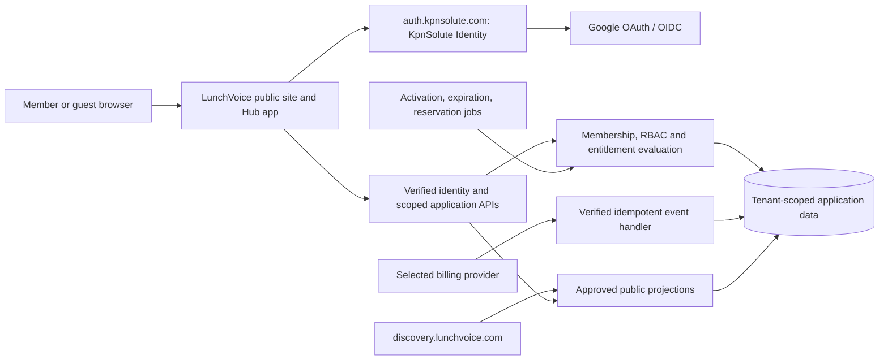

# LunchVoice v2 architecture specification

Status: target design for founder review and Claude implementation after approval.
Confirmed behavior comes from [PRODUCT_SPEC.md](PRODUCT_SPEC.md); implementation
structures below are **engineering recommendations**, not claims of existing code
or approved external-service APIs. See the [audit](CURRENT_STATE_AUDIT.md) for the
baseline at `0dbc343227bdb8f3cd5745f59c0247ae84841aec`.

## System boundaries

Keep React/TypeScript/Vite and the existing Supabase/Postgres foundation unless
an approved design decision justifies replacing them. Central identity is a
separate service to build, not a new name for `staff-sso`. Never put its client
secret or an application service-role key in the browser. This repository's
static frontend cannot safely perform confidential token exchange itself.

The exact issuer, client registration, backend/session integration, deployment
ownership, and compatibility with database authorization are D-01. Do not assume
an arbitrary central OIDC token is automatically accepted by the existing Data
API. Prototype and verify the trust boundary in non-production first.

## Identity and request authorization

Proposed registered flow:

1. Preserve an allowlisted return route and initiate central login with request
   correlation and replay protection. Use Authorization Code with PKCE where
   appropriate to the approved client model.
2. Central Identity authenticates with Google and returns a verified identity.
   Validate issuer, audience, signature, expiry, state/nonce as applicable, and
   bind the callback to the initiating request. Reject untrusted return URLs.
3. Map the verified personal ID to an immutable LunchVoice account; retain the
   issuer/subject mapping. Email and name are attributes, not permission grants.
4. Establish the approved application session. Resolve the requested Hub by its
   immutable ID and verify accepted membership and current capabilities.
5. Recheck sensitive authority against current server state, including revocation,
   ownership, subscription status, and Campaign audience. Handle logout and
   role changes without trusting indefinitely stale client claims.

Proposed authorization rule:

`allow = verified context AND correct Hub/resource binding AND audience eligibility
AND required capability (when applicable) AND current entitlement AND valid lifecycle`.

Guests use a separate scoped participation context for an explicitly guest-enabled
Campaign. A private share requires explicit creator authorization and a revocable,
unforgeable scoped proof selected in D-03. Guest context must never imply accepted
membership, access to the directory, member perks, or administrative authority.
Do not broadly open current authenticated tables to anonymous access.

## Proposed logical data model

Names below are illustrative. Claude should choose additive migrations and stable
compatibility mappings rather than rename every existing table in one migration.

| Entity | Key relationships and invariants |
| --- | --- |
| Account / identity mapping | Stable personal ID plus verified issuer/subject; one account can join many Hubs; linking is audited |
| Hub | Immutable ID, owner, settings and membership mode; canonical path slug is an independently managed address |
| Hub membership | Unique account + Hub; pending/invited/accepted/suspended/left states; only accepted valid members count |
| Role / permission / assignment | Hub-scoped custom roles, three or six slots, protected Owner outside quota; no cross-Hub assignment |
| Campaign | Hub, mode, audience, anonymous flag, explicit guest policy, schedule, lifecycle, immutable published revision |
| Survey template/questions | Existing content adapted as Survey-mode Campaign configuration; preserve legacy IDs/answer linkage |
| Eligibility/participation receipt | Unique qualifying participant per approved Campaign/window; separate from administrator-visible answers |
| Response / answer | Bound to immutable Hub/Campaign/revision; anonymity boundary survives queries, joins, exports, and publication |
| Billing customer / purchase / subscription | Provider IDs and verified lifecycle; account/Hub billing scope resolved in D-06 |
| Entitlement grant | Product source, scope, validity and limits; seasonal and subscription grants use one policy engine |
| Reservation / slug claim | Normalized unique active claim, immutable Hub binding, term/grace timestamps and generation/history |
| Page / revision / navigation | Hub content, publish state, audience and edit permission independently checked; custom-page quota |
| Analytics publication | Explicitly authorized aggregate projection and audience; no embedded private/raw response access |
| Waitlist / beta admission | Public request and separately approved owner admission; atomic 50-owner ceiling |
| Discovery application | Eligible Hub application, reviewed approval/status; count >=700 is necessary but not automatic listing |
| Audit / event receipt / job record | Actor, scoped action, event identity and outcome; idempotent/retryable without storing tokens or raw anonymous identities in admin logs |

Keep legacy `org_id` as a compatibility key where useful; the target Hub can map
to an existing org ID. Do not attach all Hub memberships to `profiles.org_id`.
Keep points/rewards and historical orders associated with their original Hub.
Database constraints and relationships must prevent cross-Hub references, not
just rely on client-side filters.

## RBAC and entitlement enforcement

Build a shared server-side policy layer used by interactive APIs, database writes,
scheduled jobs, and exports. Plan names in the UI are labels; stored grants and
limits determine authority. Enforce role/page quotas and beta admission with the
same concurrency discipline as Campaign activation. Owner-only deletion/transfer
cannot be enabled by any custom role or category-wide toggle.

Keep RLS enabled on exposed tables, explicit Data API grants, `security_invoker`
views, controlled RPC execution grants, and protected server-only secrets.
Tenant/role authority must come from verified database/app metadata, never editable
user metadata. Existing security-definer functions need explicit caller checks,
minimal privileges, and tenant-safe references before reuse in v2.

### Campaign activation transaction

Recommended sequence, to be finalized with D-04:

1. Authenticate the actor/job and resolve immutable Hub/Campaign IDs.
2. Lock the relevant Hub entitlement/activation state, or use equivalent database
   serialization that prevents two requests from consuming the final slot.
3. Verify accepted membership/capability, mode entitlement, valid purchase or
   subscription, audience, content revision, and scheduled activation conditions.
4. Count active Campaigns and active Survey-mode Campaigns using one approved
   definition of active. Enforce Starter 15 total and 2 Survey; Team 5 Survey
   and its eventual approved total cap. Missing policy must not mean unlimited.
5. Evaluate the approved additional-survey gate using distinct eligible members.
   Use integer comparisons for >50% / >=20%; exclude guests and duplicate votes.
   Apply approved bootstrap, snapshot, and window rules rather than guessing.
6. Transition once and persist activation/expiry, entitlement consumption, and a
   non-identifying audit outcome atomically. Retries return the same result.

Scheduled activation, reopening, extension, and mode change must not bypass this
path. Frontend direct writes to protected lifecycle fields must be denied. A
background job must fail visibly and retry safely if a scheduled Campaign cannot
activate; it must not silently grant unpaid access or restart its clock.

## Seasonal purchases and reservation clocks

Campaign purchase time, scheduled time, activation time, and expiry are separate.
Activation begins the purchased window. Persist a single activation event and
perform extension arithmetic once per verified purchase. Exact time semantics
and Plus prices remain D-08. Select the billing provider in D-06 before choosing
webhook schemas. Verify signature/authenticity, reject replays appropriately,
deduplicate provider events, reconcile out-of-order events, and derive grants
from authoritative payment state. Never trust a client success URL.

Name reservation is a separate entitlement: $25/12 months and $25/12-month renewal,
then 25 calendar days of grace after expiration. Store the selected calendar
timezone/semantics and explicit deadlines. A scheduled worker must atomically
recheck current renewal and ownership before releasing an overdue claim. Retried
jobs cannot release a renewed claim. Delayed jobs must not extend eligibility
indefinitely; claim APIs must evaluate expiry under the same policy.

Reclaimed slugs bind to the new owner's Hub, not the old Hub ID. Historical links,
private shares and tokens must encode or resolve an immutable resource identity
and reject mismatched generations after reassignment. Never redirect an old
private response to the new owner's workspace. D-09 chooses public historical-link
behavior and renewal/race boundaries; D-10 chooses retained-data access.

## Pages, publishing, discovery, and analytics

Canonical routing becomes `lunchvoice.com/{hubSlug}` with reserved platform paths.
Implement redirects/compatibility for legacy subdomains and LionCafe paths under
a reviewed migration plan. The discovery host serves only approved public Hub
projections; it must not publish private directory fields or member lists merely
because a Hub has 700 members.

The three-panel builder shares one draft model between navigation, preview, and
contextual settings. Desktop/mobile previews must render the same content and
audience rules as published pages. Validate external links/content blocks and
sanitize untrusted rich content. Distinguish page view, edit, and publish rights.
The built-in Shop/Leaderboard/Newsroom/Comments and custom pages require explicit
data/audience contracts before general publication.

Compute aggregates server-side or through authorized invoker views. Separate
member participation from guest counts. Use versioned Campaign/question metadata,
time windows, and eligible-member snapshots as approved. Real-time updates must
respect the same permission and privacy rules as historical queries.

For anonymous Campaigns, segregate respondent mapping from Hub-administrator
access. Threshold suppression must survive filters, comparison, export, and
embedded-publication paths. Avoid identity leaks from timestamps, tiny cohorts,
joinable IDs, or differencing. Publish only authorized aggregate projections;
revocation/unpublication must invalidate subsequent access. Retention, export
fields, and numerical suppression thresholds are D-10, not arbitrary defaults.

## Migration and rollout design

1. Inventory deployed schema/history separately when authorized; this static
   audit does not prove applied migration parity. Use an isolated non-production
   database with synthetic or approved sanitized fixtures for development.
2. Add identity mapping, memberships, roles, Campaigns, entitlements, pages, and
   reservation state. Preserve old IDs; map LionCafe accounts and sessions into
   accepted memberships and Survey-mode Campaigns with reconciliation records.
3. Reconcile row counts, response-to-question links, points balances, orders,
   menu cycles, ownership, and permissions. Test replay and interruption recovery.
4. Route legacy and v2 traffic through explicit compatibility behavior while
   migrating authentication. Never let a legacy login recreate broad admin rights
   after a v2 role revocation. Retire old paths only after signed-off parity.
5. Rehearse the December MJCC Campaign end to end in staging; verify independent
   rollback of routing/auth/content without losing newly accepted responses.
6. Produce a deployment/rollback runbook and obtain separate operational authority.
   No production migration, secret change, deployment, or destructive cleanup is
   authorized by this documentation task.

## Observability and failure handling

Record gate denials with reason codes, activation failures, event-processing lag,
reservation deadlines/releases, auth failures, role/owner changes, and migration
reconciliation. Exclude credentials, private answer bodies, and respondent
identity from administrator-visible logs. Provide retries/dead-letter review for
jobs and events, deterministic idempotency keys, and an operator recovery runbook.
Availability, latency, freshness, backup/restore, and alert thresholds must be
agreed before release and measured with the expected beta load. No unmeasured
performance or production-readiness claim is implied by the architecture.
